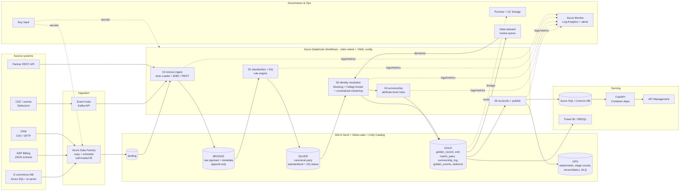
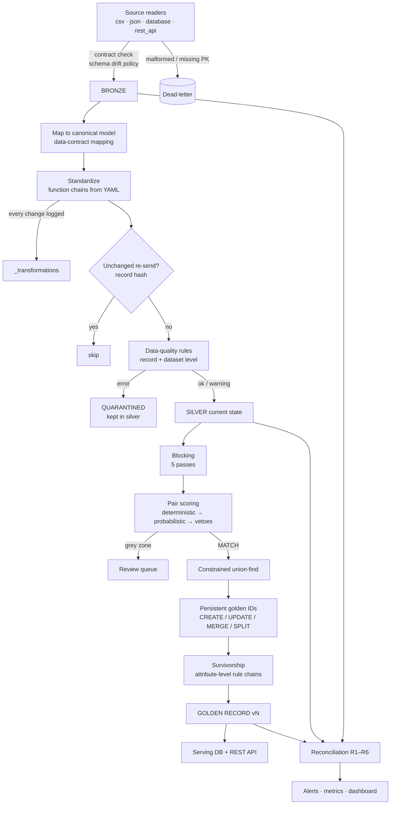

# Architecture

## 1. End-to-end view (Azure production)

## 2. Logical pipeline (identical locally and in the cloud)

## 3. Components

| Component | Code | Responsibility |
|---|---|---|
| Config & data contracts | `src/mdm/config.py`, `config/` | Load and validate all YAML. Holds reference data. |
| Ingestion | `src/mdm/ingestion/` | Format readers, incremental state (file manifest and watermarks), schema registry, contract enforcement, bronze write |
| Standardization | `src/mdm/standardization/` | Function registry (names, phones → E.164, dates, ISO country, states, postal, address abbreviations, vocabularies), field-level lineage |
| Data quality | `src/mdm/quality/` | Rule-type catalogue, sandboxed expressions, record and dataset results, scorecard |
| Identity resolution | `src/mdm/matching/` | Blocking, comparators, Fellegi-Sunter scorer, vetoes, constrained clustering, persistent IDs, steward overrides, incremental pair reuse |
| Survivorship | `src/mdm/survivorship/` | Attribute-level rule chains, attribute groups, versioning (SCD2), decision log |
| Lineage | `src/mdm/lineage/` | OpenLineage dataset events plus a record-level `build_trace(golden_id)` |
| Reconciliation | `src/mdm/reconciliation/` | Checks R1–R6 and Q1 across stages, exception playbook, JSON and Markdown reports |
| Observability | `src/mdm/observability/` | JSON logging, metrics and alerts, retry/backoff, DLQ, dashboard |
| Storage | `src/mdm/storage/lake.py` | Medallion store abstraction (Delta in production), per-run versions |
| Serving | `src/mdm/serving/` | Repository, FastAPI app, stdlib fallback server |
| Orchestration | `src/mdm/pipeline.py`, `orchestration/` | Stage sequencing, run manifest. ADF + Databricks DAG in production |
| Spark jobs | `spark/jobs/` | Production versions of each stage reusing the package |

## 4. Key architectural decisions

| # | Decision | Rationale | Trade-off accepted |
|---|---|---|---|
| AD-1 | Lakehouse (Delta) instead of an RDBMS-only MDM hub | Scale, cheap storage, ACID MERGE, time travel, one copy for ops and analytics | Point lookups need a separate serving store |
| AD-2 | Bronze stores the raw payload as JSON | Never lose data. Replay after a rule fix. Immune to schema drift. | Bronze is not query-friendly (it isn't meant to be) |
| AD-3 | Silver is current-state per source record; history stays in bronze | Matching works on the latest truth of each source. Simple MERGE. | Point-in-time silver needs Delta time travel |
| AD-4 | Quarantine instead of drop | Nothing silently disappears, and reconciliation balances | Quarantined rows need a stewardship process |
| AD-5 | Attribute-level survivorship with grouped addresses | Best value per attribute, with no Frankenstein addresses | More complex than record-level "best record wins" |
| AD-6 | Persistent golden IDs with MERGE redirects | Downstream systems store IDs. IDs must be stable and merges must be followable. | ID-assignment logic is the most delicate code, so it is guarded by tests |
| AD-7 | Explainable probabilistic matching with vetoes, rather than a black-box ML model | Auditability, no labels needed, precision-first | Slightly lower recall than a tuned ML model, which can be added later |
| AD-8 | Incremental at every stage | Cost scales with change volume, not master size | More state to manage (watermarks, hashes, pair cache) |
| AD-9 | Config-driven rules plus code-defined rule types | Business changes without deployment, but still reviewed and CI-validated | Config can only express what rule types allow (deliberately) |
| AD-10 | Single concurrent run of the gold stage | ID assignment and MERGE must be serialisable | Throughput bounded per entity domain (shard by domain if needed) |

## 5. Scalability path (10⁷–10⁸ records, dozens of sources)

- **Ingestion.** Auto Loader in file-notification mode (Event Grid) handles millions of files. JDBC partitioned reads. One bronze table per source, so a new source is isolated.
- **Standardization and DQ.** Embarrassingly parallel `mapInPandas`, which scales linearly with workers.
- **Matching.** Cost is about Σ(block size²). It is controlled by `max_block_size`, multiple selective passes, skipping hot keys, and **incremental scoring** (only pairs touching changed records). Connected components run in O(graph diameter) iterations.
- **Survivorship.** `applyInPandas` per `golden_id`, only for touched IDs.
- **Serving.** CDF-driven incremental sync, with an indexed Azure SQL table or a Cosmos container partitioned by `golden_id`.
- **Multi-domain.** Party, product and location each get their own config set and catalog schema, using the same engine.
