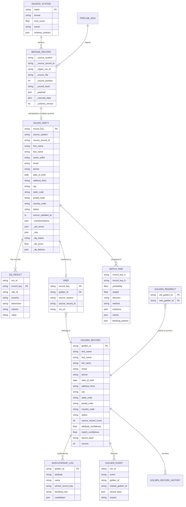

# Logical data model

## Entities

### Source entities (bronze)
One append-only table per source system, holding the raw record exactly as delivered (`_payload`) plus technical metadata. Bronze is the system of record for *what we received and when*. It is partitioned by run, and old partitions are tiered to cool storage.

### Canonical entity: `silver.party`
The **canonical party model** is the shape every source is mapped into (see `CANONICAL_ATTRIBUTES` in `standardization/engine.py`).

| group | attributes | notes |
|---|---|---|
| identity | `record_key` (= `source_system:source_record_id`), `source_system`, `source_record_id`, `source_trust` | natural key; trust drives survivorship confidence |
| name | `first_name`, `last_name`, `full_name`, `name_suffix` | suffix parsed out so Jr/Sr can veto |
| contact | `email` (lower), `phone` (E.164) | placeholders nulled |
| demographics | `date_of_birth` (ISO date) | parsed with source-specific formats |
| address | `address_line1`, `city`, `state_code` (USPS), `postal_code`, `country_code` (ISO-3166 α-2) | standardized for matching and survivorship as a group |
| lifecycle | `status` (ACTIVE / INACTIVE / PROSPECT), `source_updated_at` (UTC) | controlled vocabulary |
| lineage | `_raw`, `_transformations`, `_std_errors`, `_record_hash`, `_ingest_run_id`, `_source_file`, `_source_position` | field-level lineage |
| quality | `_dq_status`, `_dq_score`, `_dq_failures`, `_dq_run_id` | quarantine flag + explanation |

Silver keeps the **current state per source record**: a newer version replaces the old one (out-of-order safe), and history lives in bronze and Delta versions.

### Golden record: `gold.golden_record`
One row per real-world party: the survived attributes, `source_record_count`, `source_systems`, `member_record_keys`, `attribute_confidence`, `match_confidence` (weakest link), `record_hash`, `version`, `created_run_id`, `updated_run_id`. **`gold.xref`** is the authoritative member list (source key → golden ID). It answers "which golden record is CRM customer C123?" and is what operational systems use to sync back.

### Lineage and metadata
| table | purpose |
|---|---|
| `gold.match_pairs` | every compared pair, its decision and the per-attribute evidence |
| `gold.survivorship_log` | per golden record per attribute: winner, deciding rule, all candidates |
| `gold.golden_events` | CREATE / UPDATE / MERGE / SPLIT / RETIRE |
| `gold.golden_record_history` | SCD2 versions (Change Data Feed in production) |
| `gold.golden_redirects` | merged-away ID → survivor (chains collapsed) |
| `gold.review_queue` | pairs awaiting steward decision |
| `silver.dq_results`, `silver.dq_dataset_results` | rule hits per record and per batch |
| `_state/ingestion_state.json` | watermarks, processed-file manifest, schema registry (versions) |
| `_runs.jsonl` | run manifests (status, metrics, timings, alerts) |
| `_lineage/openlineage_*.jsonl` | dataset-level lineage events |
| `_dead_letter/*.jsonl` | unprocessable records with reason codes |
| `config/sources/*.yaml` | **data contracts** (technical + business metadata: owner, trust, schema, mapping) |

Physical Delta DDL with keys, constraints, clustering and PII masks is in [`spark/sql/ddl.sql`](../spark/sql/ddl.sql).
